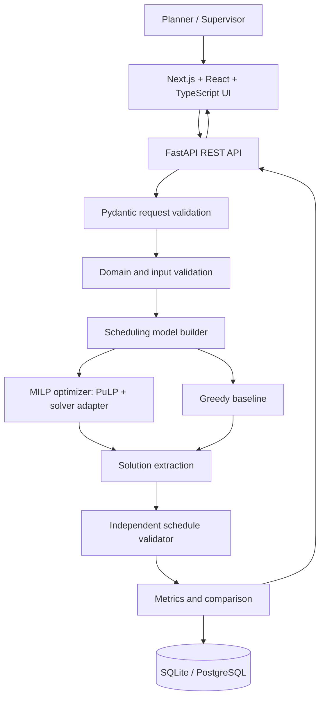

# Ordivanta — Workforce Scheduling & Shift Optimization

> **Operations Research-Based Workforce Scheduling and Shift Optimization System for Manufacturing Industries**

Ordivanta is a prototype-oriented workforce planning application for assigning employees to manufacturing units and shifts while respecting staffing demand, skills, availability and working-hour limits. Its optimisation layer uses a Mixed-Integer Linear Programming (MILP) model; a Greedy scheduler provides a transparent baseline for comparison.

**Team members**
- Abhishek
- Krrish Sharma
- Mohammed Ayaan Adil Ahmed
- Tejas J Ambig

> Team member names are listed as supplied. Add each member's agreed role and contribution before submission; do not attribute completed work without confirming it with the team.

---

## 1. Problem and purpose

Manufacturing teams must staff the right production unit, at the right time, with enough qualified and available employees. Spreadsheet-based scheduling becomes harder to audit as the number of workers, shifts and units grows. An apparently complete roster may still contain skill mismatches, unavailable employees, duplicate assignments or uncovered demand.

Ordivanta aims to turn these decisions into a repeatable, explainable workflow:

1. Maintain employee, skill, unit, shift and demand data.
2. Validate inputs before optimisation.
3. Generate a roster using a mathematical optimisation model.
4. Independently validate the returned roster.
5. Show coverage, workload, cost-related metrics (only when cost data is configured), warnings and solver status.
6. Compare the MILP result with a Greedy baseline on the same input.

The system is a decision-support tool. A supervisor should review the result before publishing a roster.

## 2. Core scope

### MVP requirements
- Employee records with skills, availability and maximum scheduled hours.
- Production units with required skills and per-shift staffing demand.
- Shift definitions with start/end times and duration.
- Input validation with actionable error messages.
- MILP assignment model.
- Greedy baseline for comparison.
- Independent post-solve validation.
- Clear `OPTIMAL`, `FEASIBLE`, `INFEASIBLE`, `NOT_SOLVED` or solver-error reporting as supported by the chosen solver adapter.
- Schedule table, coverage summary, workload distribution and validation findings.
- Synthetic sample data and repeatable experiment scenarios.
- Export of a schedule to CSV.

### Explicitly not promised by the basic model
Unless implemented and tested, do **not** claim automatic live factory integration, predictive demand forecasting, payroll integration, fatigue modelling, legally compliant rest-period enforcement, employee self-service, real-time rescheduling or guaranteed optimality for every run.

## 3. Recommended architecture



### Architectural principles
- **Separate UI from optimisation:** the browser never implements the solver.
- **Validate twice:** validate inputs before solving and assignments after solving.
- **Solver abstraction:** keep solver-specific status and configuration behind an adapter.
- **Explain outcomes:** show why a roster is accepted, rejected or infeasible.
- **No silent infeasibility:** never display an invalid or partial roster as a successful complete schedule.
- **Reproducibility:** store the input scenario, algorithm, configuration, objective components and run metadata when persistence is enabled.

## 4. Suggested repository layout

```text
ordivanta/
├── README.md
├── docs/
│   ├── PRD.md
│   ├── TECHNICAL_DESIGN.md
│   └── DESIGN.md
├── AGENTS.md
├── skills/
│   ├── scheduling-model/SKILL.md
│   ├── api-engineering/SKILL.md
│   └── frontend-design/SKILL.md
├── frontend/                 # Next.js application
│   ├── app/
│   ├── components/
│   ├── features/
│   ├── lib/
│   └── public/
└── backend/                  # FastAPI application
    ├── app/
    │   ├── main.py
    │   ├── api/routes/
    │   ├── schemas/
    │   ├── domain/
    │   ├── services/
    │   ├── optimization/
    │   ├── validation/
    │   ├── metrics/
    │   └── persistence/
    ├── tests/
    └── pyproject.toml
```

Treat this as the target structure, not proof that every path already exists. Adapt it to the existing repository before creating files; reuse existing modules rather than duplicating them.

## 5. Technology stack

| Layer | Choice | Tested Version | Why |
|---|---|---|---|
| Web UI | Next.js + React | 16.4.2 / 19.0.0 | Structured multi-page web interface with App Router |
| Language | TypeScript | 5.x | Safer contracts between UI components and backend types |
| Styling | Tailwind CSS + PostCSS | 4.0.0 (`@tailwindcss/postcss`) | Design tokens from `docs/DESIGN.md` and responsive layout |
| Charts | Recharts | 2.12.7 | Coverage and workload horizontal/vertical bar visualizations |
| API | Python + FastAPI | 0.111.0 (Python 3.11–3.13) | Typed REST endpoints, Pydantic v2 schemas, OpenAPI specs |
| Request/response validation | Pydantic | 2.7.4 | Reject malformed input early with structured error codes |
| Optimisation model | PuLP | 4.2.0 | Express mixed-integer linear programming formulations |
| Solver | HiGHS | 1.9.0 (`highspy`) | High-performance open-source MILP solver |
| Data | SQLite + SQLAlchemy | 2.0.30 (`aiosqlite`) | Prototype persistence with migration path to PostgreSQL |
| Tests | pytest | 9.1.1 (`pytest-asyncio`) | Unit, API integration, and benchmark verification |
| Packaging | pnpm & pip/venv | pnpm 10.x, Python venv | Reproducible local development and virtualenv packaging |

**No Streamlit is used or recommended.** Pin and test exact dependency versions during implementation. Confirm solver availability in the target environment before relying on it.

## 6. Mathematical Optimisation Model

### Sets and Parameters
- \(I\): Employees, \(J\): Production units / workstations, \(S\): Shift intervals.
- \(d_{js}\): Required headcount demand for unit \(j\) in shift \(s\).
- \(a_{is} \in \{0, 1\}\): Availability indicator (1 if employee \(i\) is available for shift \(s\)).
- \(q_{ij} \in \{0, 1\}\): **Disjunctive Qualification Indicator**. In manufacturing cells with multiple skill competencies, an operator is qualified if the unit specifies no skills or the operator holds at least one of the unit's required skills:
  \[
  q_{ij} = \begin{cases} 1 & \text{if } S_j^{\text{unit}} = \emptyset \text{ or } (S_i^{\text{emp}} \cap S_j^{\text{unit}} \neq \emptyset) \\ 0 & \text{otherwise} \end{cases}
  \]
- \(h_s\): Duration of shift \(s\) in hours.
- \(H_i\): Employee \(i\)'s maximum scheduled hours limit.
- \(x_{ijs} \in \{0, 1\}\): Binary assignment variable (1 if employee \(i\) works in unit \(j\) on shift \(s\)).

### Hard Constraints
Coverage:
\[
\sum_{i \in I} x_{ijs} \ge d_{js} \quad \forall j \in J, s \in S
\]
Availability & Skills (enforced by domain variable truncation):
\[
x_{ijs} \le a_{is}, \quad x_{ijs} \le q_{ij} \quad \forall i, j, s
\]
At most one unit assignment per employee per shift:
\[
\sum_{j \in J} x_{ijs} \le 1 \quad \forall i \in I, s \in S
\]
Maximum scheduled hours limit:
\[
L_i = \sum_{j \in J} \sum_{s \in S} h_s x_{ijs} \le H_i \quad \forall i \in I
\]

### Explicit Mathematical Objectives
When monetary hourly wage data is absent from the schema:
1. **Total Scheduled Hours Term (Non-Monetary Assignment Efficiency Proxy):**
   \[
   Z_{\text{hours}} = \sum_{i \in I} \sum_{j \in J} \sum_{s \in S} h_s x_{ijs}
   \]
   Minimizing \(Z_{\text{hours}}\) eliminates unnecessary over-allocation and meets demand with minimum staffing hours.
2. **Workload Fairness Term (Linear Mean Absolute Deviation):**
   Target workload per employee: \(\bar{H} = \frac{\sum_{j,s} h_s d_{js}}{|I|}\).
   Linear absolute deviation constraints:
   \[
   u_i \ge L_i - \bar{H}, \quad u_i \ge \bar{H} - L_i \quad \forall i \in I
   \]
   \[
   Z_{\text{fairness}} = \sum_{i \in I} u_i \quad (L_1 \text{ workload deviation across all workers})
   \]
3. **Objective Configurations:**
   - `FEASIBILITY`: \(\min Z = Z_{\text{hours}}\) (minimizes scheduled hours to meet demand).
   - `COST`: \(\min Z = Z_{\text{hours}} + w_{\text{fairness}} \cdot Z_{\text{fairness}}\) (total hours plus configured fairness weight).
   - `FAIRNESS`: \(\min Z = Z_{\text{hours}} + Z_{\text{fairness}}\) (balances shift distribution while preventing gratuitous over-staffing).
   - **Two-Stage Optimization (`two_stage=True`):**
     - *Stage 1:* Solve \(\min Z_{\text{hours}} \to H^*\).
     - *Stage 2:* Enforce \(Z_{\text{hours}} \le H^* \cdot (1 + \text{tolerance})\) and solve \(\min Z_{\text{fairness}}\). Guaranteed to optimize workload equity without exceeding minimum staffing hours.

## 7. Illustrative code blocks

These snippets explain the core idea. They are examples, not a claim that the current repository already contains identical code.

### Binary assignment variable and coverage constraint (PuLP)

```python
import pulp

model = pulp.LpProblem("workforce_schedule", pulp.LpMinimize)

x = {
    (i, j, s): pulp.LpVariable(f"x_{i}_{j}_{s}", cat="Binary")
    for i in employees
    for j in units
    for s in shifts
}

for j in units:
    for s in shifts:
        model += (
            pulp.lpSum(x[i, j, s] for i in employees) >= demand[j, s],
            f"coverage_{j}_{s}",
        )
```

### Availability and qualification restrictions

```python
for i in employees:
    for j in units:
        for s in shifts:
            if not availability[i, s] or not qualified[i, j]:
                model += x[i, j, s] == 0
```

### Independent validation principle

```python
def validate_assignments(assignments, input_data):
    violations = []
    # Recompute coverage, availability, qualification,
    # duplicate assignments and hours from extracted assignments.
    # Do not trust solver variables alone as the final report.
    return violations
```

A production implementation should return structured violations (code, severity, entity IDs, human-readable explanation) and test every rule.

## 8. User workflow

1. **Open dashboard** — see the active scenario and latest run status.
2. **Prepare data** — add or import employees, skills, production units, shifts and staffing demand.
3. **Validate inputs** — fix missing fields, invalid shift times, duplicate IDs and impossible references.
4. **Configure run** — select MILP or Greedy; choose supported objective settings and time limit.
5. **Generate schedule** — backend builds the model and runs the selected algorithm.
6. **Review status** — distinguish optimal, feasible, infeasible, timed out and failed runs.
7. **Inspect roster** — filter by shift, unit or employee; inspect unfilled demand and validation issues.
8. **Compare** — evaluate both methods on identical data using coverage, violations, objective value (if defined), workload distribution and solve time.
9. **Export and review** — export CSV and obtain supervisor approval before using the roster operationally.

## 9. API outline

| Method | Endpoint | Purpose |
|---|---|---|
| GET | `/api/health` | Health check and solver availability verification |
| GET/POST | `/api/employees` | List/create employees |
| GET/POST | `/api/units` | List/create production units |
| GET/POST | `/api/shifts` | List/create shift definitions |
| GET/POST | `/api/scenarios` | List/create input scenarios |
| GET | `/api/scenarios/{id}` | Retrieve scenario details |
| POST | `/api/scenarios/{id}/validate` | Validate input scenario against 9 domain rules |
| POST | `/api/scenarios/sample` | Load built-in reference manufacturing scenario |
| POST | `/api/schedules/solve` | Run MILP or Greedy optimization |
| GET | `/api/schedules` | List recent schedule runs |
| GET | `/api/schedules/{run_id}` | Retrieve run metadata and assigned rosters |
| GET | `/api/schedules/{run_id}/metrics` | Retrieve independent validation metrics |
| GET | `/api/schedules/{run_id}/export` | Download verified CSV roster (blocked for infeasible/error runs) |
| GET | `/api/datasets` | List benchmark & synthetic datasets with compatibility metadata |
| GET | `/api/datasets/{dataset_id}` | Retrieve dataset metadata and constraint mapping notes |
| GET | `/api/datasets/{dataset_id}/instances` | List all available instances for a dataset |
| GET | `/api/datasets/{dataset_id}/instances/{instance_id}` | Retrieve instance summary, headcount, and compatibility |
| POST | `/api/datasets/{dataset_id}/load/{instance_id}` | Import instance, transform to domain scenario, and persist |

Use explicit Pydantic schemas, stable error codes and a consistent API response envelope. Solves are CPU-bound and executed via thread offloading (`asyncio.to_thread`) to prevent blocking the event loop.

## 10. Integrated Benchmark & Synthetic Datasets

Ordivanta supports 4 distinct dataset sources accessible via the API, UI Wizard, and Experiments tab:

1. **Synthetic Manufacturing Dataset (Primary):**
   - Source: [`backend/app/sample_data.py`](file:///c:/Users/moham/Downloads/Projectss/Ordivanta/backend/app/sample_data.py) & [`backend/app/datasets/synthetic_loader.py`](file:///c:/Users/moham/Downloads/Projectss/Ordivanta/backend/app/datasets/synthetic_loader.py)
   - Scope: 3 reproducible industrial instances (Standard Facility, High Demand, Shortage Deficit).
   - Compatibility: **100% Fully Compatible**. Represents exact factory operations with workstation qualification requirements, availability windows, and maximum working-hour caps.
2. **Shift Scheduling Benchmark (225 instances):**
   - Source: `data/instances1_225/` (225 multi-activity NRP text instances).
   - Scope: 1 to 7-day planning horizons, 15-minute intervals, workstation activities.
   - Compatibility: **Partially Compatible**. Mapped discrete intervals, demand, qualifications, and max hours. Unsupported min-hours and meal break placement constraints are documented transparently.
3. **Personnel Task Scheduling Problem / PTSP (137 instances):**
   - Source: `data/ptask/ptsp/` (137 `.dat` instances).
   - Scope: Multi-skilled workers assigned to task durations and demand.
   - Compatibility: **Partially Compatible**. Tasks mapped to discrete demand shifts and qualifications. Continuous timeline interval collision constraints are documented as unsupported.
4. **Nurse Rostering Benchmark (24 instances):**
   - Source: `data/instances1_24/` (24 INRC-II text instances).
   - Scope: 14 to 28-day ward coverage with mandatory day-off calendar.
   - Compatibility: **Partially Compatible**. Mapped days off, shift durations, ward demand, and max hours. Unsupported consecutive stretch and forbidden transition rules are documented transparently.

## 11. Local development

### Prerequisites
- Python 3.11, 3.12, or 3.13
- Node.js 18+ and `pnpm`

### Environment Configuration
```powershell
# Copy environment template
Copy-Item .env.example backend\.env
Copy-Item .env.example frontend\.env.local
```

### Backend Setup & Execution
```powershell
cd backend
python -m venv .venv
.\.venv\Scripts\Activate.ps1
pip install -e ".[dev]"
python -m uvicorn app.main:app --host 127.0.0.1 --port 8000 --reload
```

### Frontend Setup & Execution
```powershell
cd frontend
pnpm install
pnpm run dev
# Open http://localhost:3000
```

### Running Tests & Evaluation Benchmarks
```powershell
# Run backend test suite (58 unit, integration, and metaheuristic tests)
backend\.venv\Scripts\pytest backend\tests

# Run cross-dataset MILP vs. Greedy vs. ALNS benchmark with statistical repetitions
backend\.venv\Scripts\python backend\tests\benchmark.py
```

## 12. Quality, Safety & Known Limitations

### Safety Checklist
- [x] Validate all input IDs, string fields, and foreign entity references.
- [x] Availability, qualification, one-assignment-per-shift, and maximum hours enforced as strict hard constraints.
- [x] `OPTIMAL` status returned **only** when MILP solver explicitly proves global optimality.
- [x] Independent post-solve validator verifies assignments using source data — does not trust solver variables.
- [x] Infeasible scenarios report `INFEASIBLE`; no fake complete roster is ever presented.
- [x] Synthetic sample data is isolated from production API paths.
- [x] Status communicated with explicit text badges + symbols, never color alone.
- [x] CSV export blocked for `INFEASIBLE` and `ERROR` runs (`EXPORT_NOT_PERMITTED` 409 error).

### Solvers & Metaheuristics
- **MILP (HiGHS):** Primary exact solver; guarantees proven global optimality for feasible schedules and mathematical certificates of infeasibility.
- **Greedy Baseline:** Deterministic fast heuristic baseline; returns feasible or partial solutions in sub-millisecond time.
- **ALNS Metaheuristic:** Adaptive Large Neighbourhood Search using destroy operators (Random, Shift-based, Worst-fairness) and repair operators (Greedy capacity, Fairness regret). Essential for large-scale combinatorial instances where exact branch-and-cut times out.

### Known Limitations
- **Single-User Prototype:** SQLite persistence designed for local decision support; multi-user concurrent deployment with PostgreSQL is `[planned]`.
- **Wage Data Absence:** Input schema does not currently define monetary employee wage rates. Cost minimization is accurately implemented and labeled as Total Scheduled Hours minimization.
- **Continuous Timeline Non-Overlap:** Discrete shift slots model operations cleanly; continuous non-preemptive disjunctive job scheduling without fixed slots is `[planned]`.

## 13. References

- Google OR-Tools, *Employee Scheduling*: https://developers.google.com/optimization/scheduling/employee_scheduling
- Google OR-Tools, *Constraint Optimization*: https://developers.google.com/optimization/cp
- PuLP documentation: https://coin-or.github.io/pulp/
- IBM Design Language, *Color*: https://www.ibm.com/design/language/color/
- IBM Design Language, *Technical diagrams*: https://www.ibm.com/design/language/infographics/technical-diagrams/design/
- Michelin Design System, *Principles of a dashboard*: https://designsystem.michelin.com/data-visualization/design-guidelines/principles-of-a-dashboard

These references inform design and implementation choices; they do not establish that any unimplemented feature is complete.
