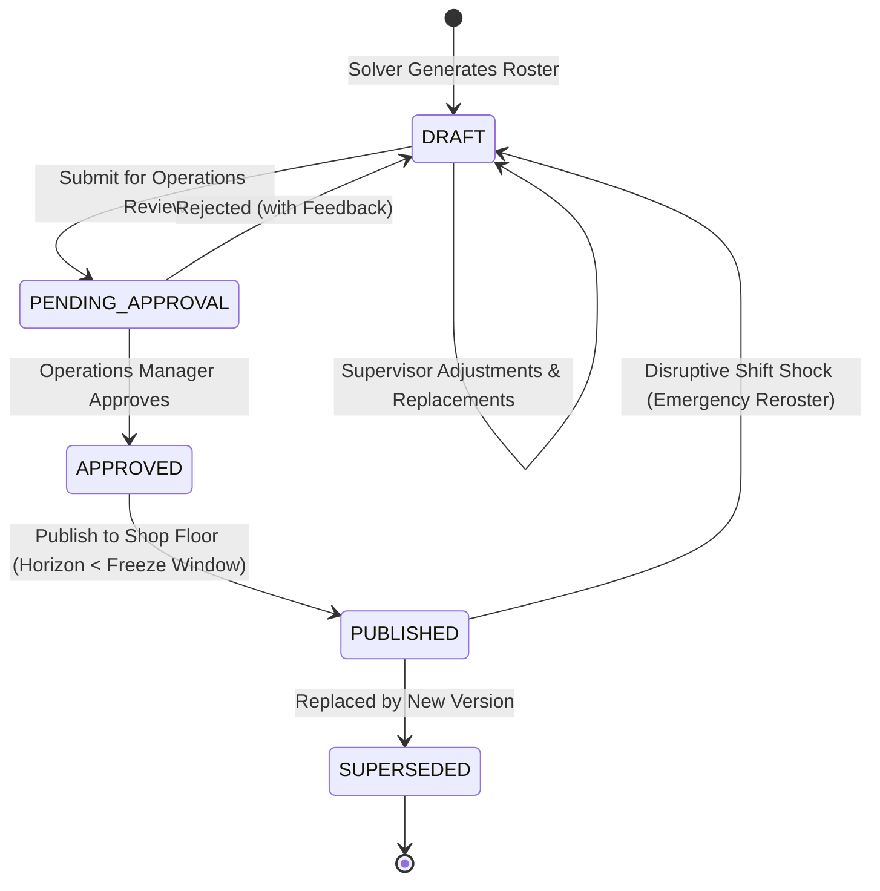
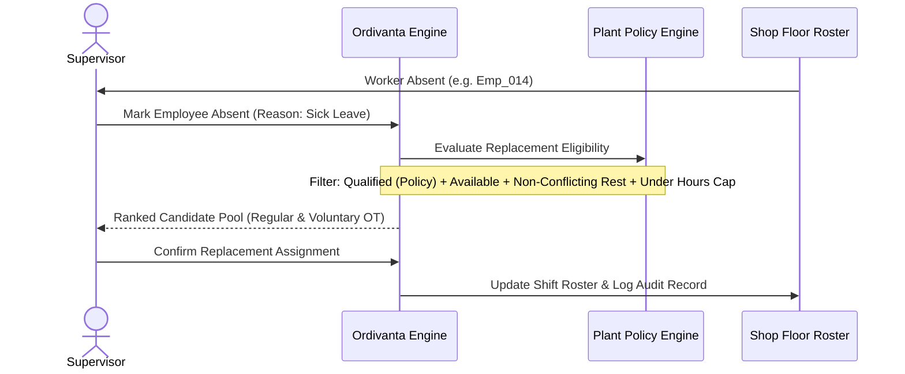

# Manufacturing Operational Workflows

## 1. Schedule Lifecycle State Machine

### State Definitions
- **`DRAFT`:** Working candidate schedule produced by MILP, Recovery MILP, or manual supervisor edits. Never exposed to floor workers.
- **`PENDING_APPROVAL`:** Frozen draft undergoing review by plant management.
- **`APPROVED`:** Authorized schedule verified by independent validation.
- **`PUBLISHED`:** Active shop-floor roster. Shift times and workstations are locked.
- **`SUPERSEDED`:** Historical revision archived for compliance and audit reporting.

---

## 2. Shift Disruption & Shortage Resolution Workflow

When a worker calls in sick or an unplanned absence occurs:

---

## 3. Worker State Distinctions
To maintain transparency and labor relations:
1. **Available:** Scheduled on regular shift window, qualified, not absent, and has available hours.
2. **Consenting Overtime Volunteer:** Has active opt-in consent on file, but must be confirmed before shift assignment.
3. **On-Call Candidate:** Available for call-in notification within minimum lead hours; assignment requires affirmative supervisor confirmation.
4. **Absent:** Excluded from all assignment eligibility for the duration of absence.
