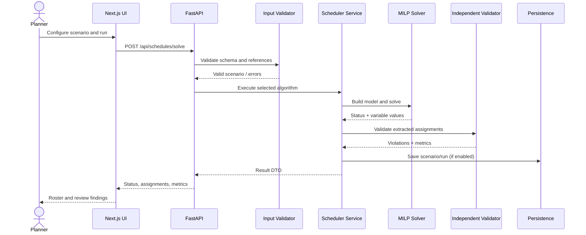

# Technical Design Document
## Ordivanta — Workforce Scheduling & Shift Optimization

## 1. Purpose and design constraints

This document defines a maintainable implementation path for the workforce scheduling project. It assumes a Next.js frontend, FastAPI backend and a Python MILP model. It is a target architecture: inspect the current repository before adding files and adapt existing components rather than duplicating them.

## 2. System context



## 3. Component responsibilities

### Frontend
- Collect and display data.
- Validate basic form-level requirements for usability, without replacing backend validation.
- Send typed requests to the API.
- Render solver status, roster, metrics and validation findings.
- Avoid putting optimisation logic in the browser.

### API layer
- Own request/response contracts.
- Enforce payload size and validation limits.
- Map domain exceptions to stable HTTP errors.
- Apply CORS and request logging.
- Keep endpoints thin; delegate business logic to services.

### Domain and validation layer
- Define canonical Employee, Unit, Shift, Demand, Scenario, Assignment and ScheduleRun types.
- Validate cross-entity references and logical consistency.
- Provide structured errors rather than plain unstructured strings.

### Optimisation layer
- Build variables, objective and hard constraints.
- Call the solver through a small adapter.
- Extract assignments only when a solution exists.
- Translate solver status into application-level status.
- Never assume a solver result is optimal unless it explicitly reports optimality.

### Independent schedule validator
Recompute the rules from the original input and extracted assignment list. Do not rely only on the internal model to decide whether the roster is safe to show as valid.

### Metrics layer
- Coverage by unit/shift.
- Number of unfilled positions.
- Hard-constraint violation count.
- Employee hours and workload spread.
- Objective components that were actually configured.
- Solver runtime and status.

### Persistence layer
- Save scenario snapshots and run metadata when persistence is included.
- Use stable IDs and timestamps.
- Store solver parameters and objective configuration so results can be reproduced.
- SQLite is appropriate for a single-user prototype; use PostgreSQL for concurrent or deployed multi-user operation.

## 4. MILP formulation

### Sets and parameters
- \(I\): employees.
- \(J\): production units.
- \(S\): shifts.
- \(d_{js}\): required headcount.
- \(a_{is}\): availability indicator.
- \(q_{ij}\): qualification indicator.
- \(h_s\): shift duration.
- \(H_i\): employee hour limit.
- \(c_{ijs}\): assignment cost, if provided.

### Decision variable

\[
x_{ijs} =
\begin{cases}
1 & \text{if employee }i\text{ works in unit }j\text{ on shift }s\\
0 & \text{otherwise}
\end{cases}
\]

### Hard constraints

Coverage:

\[
\sum_{i\in I}x_{ijs}\ge d_{js}\quad\forall j\in J,s\in S
\]

Availability and skills:

\[
x_{ijs}\le a_{is},\quad x_{ijs}\le q_{ij}\quad\forall i,j,s
\]

At most one unit per employee per shift:

\[
\sum_{j\in J}x_{ijs}\le1\quad\forall i,s
\]

Maximum scheduled hours:

\[
\sum_{j\in J}\sum_{s\in S}h_sx_{ijs}\le H_i\quad\forall i
\]

Binary domain:

\[
x_{ijs}\in\{0,1\}
\]

The basic model does not automatically enforce rest intervals between shifts, day-level overlap, overtime premiums, contract-specific minimum hours or employee preferences. Add each as an explicit rule only when data and requirements are defined.

### Objective strategy
If assignment cost is available:

\[
\min C=\sum_{i,j,s}c_{ijs}x_{ijs}
\]

For fairness, define \(L_i\) as assigned hours and \(T_i\) as an appropriate target. Add nonnegative deviation variables \(u_i\) such that \(u_i\ge L_i-T_i\) and \(u_i\ge T_i-L_i\), then minimise \(\sum_i u_i\) as a separate or weighted objective.

If combining cost, overtime and fairness, normalise units and document weights. Consider a two-stage strategy: first optimise the primary objective, then improve fairness while allowing only a documented tolerance in the primary objective. Keep all hard constraints hard.

## 5. Solver adapter and statuses

Create a narrow interface so the rest of the app does not depend on solver-specific APIs:

```python
from dataclasses import dataclass
from typing import Any

@dataclass
class SolveOutcome:
    status: str
    assignments: list[dict[str, Any]]
    objective_value: float | None
    runtime_seconds: float
    message: str | None = None
```

Status mapping should preserve distinctions:
- `OPTIMAL`: solver proves optimality.
- `FEASIBLE`: valid incumbent found, optimality not proved.
- `INFEASIBLE`: solver proves no feasible solution for the model.
- `NOT_SOLVED`: time limit or termination without a usable solution, depending on solver details.
- `ERROR`: configuration or solver exception.

Map actual solver statuses carefully; different solvers expose different termination codes. Never infer `OPTIMAL` from the mere presence of assignments.

## 6. Suggested backend modules

```text
backend/app/
├── main.py
├── api/routes/
│   ├── health.py
│   ├── workforce.py
│   ├── scenarios.py
│   └── schedules.py
├── schemas/
│   ├── employee.py
│   ├── scenario.py
│   └── schedule.py
├── domain/
│   ├── models.py
│   └── enums.py
├── services/
│   ├── scenario_service.py
│   └── schedule_service.py
├── validation/
│   ├── input_validator.py
│   └── schedule_validator.py
├── optimization/
│   ├── base.py
│   ├── milp_scheduler.py
│   ├── greedy_scheduler.py
│   └── solver_adapter.py
├── metrics/
│   └── schedule_metrics.py
└── persistence/
    ├── repository.py
    └── database.py
```

These names are suggestions. Merge them into the existing codebase where equivalent functionality already exists.

## 7. Suggested API contracts

### Solve request
```json
{
  "scenario_id": "demo-week-01",
  "algorithm": "milp",
  "objective": {
    "primary": "feasibility",
    "include_assignment_cost": false,
    "fairness_weight": 0
  },
  "time_limit_seconds": 30
}
```

The example deliberately sets a feasibility-first objective because it contains no cost data. Validate supported objective options and reject unknown keys.

### Result response (illustrative)
```json
{
  "run_id": "run-example",
  "status": "OPTIMAL",
  "algorithm": "milp",
  "runtime_seconds": 0.18,
  "objective_value": 0,
  "assignments": [],
  "metrics": {
    "coverage_rate": 1.0,
    "unfilled_positions": 0,
    "hard_constraint_violations": 0
  },
  "warnings": []
}
```

This is a schema illustration, not a real benchmark result. In production, distinguish a mathematically optimal objective from a feasible solution and ensure metrics are computed from extracted assignments.

## 8. Frontend information architecture

- **Dashboard:** latest run, staffing coverage, pending issues and shortcuts.
- **Workforce:** employee table, skill tags, availability and hour limits.
- **Production units:** unit definitions and qualification needs.
- **Shift demand:** shifts and required headcount matrix.
- **Schedule builder:** scenario preview, algorithm and objective configuration.
- **Schedule results:** roster, coverage matrix, employee workload and validation panel.
- **Experiments:** side-by-side MILP/Greedy results and scenario metadata.
- **Settings:** API health, solver availability and configuration.

Use a typed API client and feature-level components. Keep tables, status chips, filters and metric cards reusable.

## 9. Testing strategy

### Unit tests
- Input schema and cross-reference validation.
- Each hard constraint in the independent validator.
- Objective calculation.
- Status mapping.
- Metrics calculations.
- Greedy deterministic behaviour on fixed inputs.

### Integration tests
- Valid scenario → solve → extract → validate → result response.
- Infeasible scenario → explicit infeasible response.
- Solver unavailable → actionable error.
- Export output matches validated assignments.
- API returns correct status codes and schema.

### Regression cases
1. All demand is zero.
2. Demand can be fully covered.
3. Not enough qualified employees.
4. Only qualified employees are unavailable.
5. Employee hour limit blocks full coverage.
6. Duplicate or malformed entity IDs.
7. Solver time limit reached.
8. Schedule contains an injected violation and validator catches it.

## 10. Benchmark methodology

- Generate small, medium and larger deterministic scenarios.
- Run MILP and Greedy on identical data and rules.
- Record machine/environment, solver version, parameters, runtime, status, objective and validation findings.
- Repeat runs if runtime variability matters.
- Do not compare objective values across different objective definitions.
- Report infeasibility rather than omitting failed scenarios.
- Keep benchmark inputs under version control.

## 11. Security and operations

- Configure CORS to known frontend origins.
- Keep secrets in environment variables.
- Limit request sizes and validate all incoming data.
- Avoid logging unnecessary personal details.
- Add health checks and meaningful error responses.
- Use a background worker if optimisation time grows beyond the acceptable request window.
- Pin and audit dependencies and confirm solver licensing before distribution.

## 12. Deployment plan

Prototype:
- Next.js frontend.
- FastAPI backend.
- SQLite database.
- MILP solver installed in backend environment.

Future deployment:
- PostgreSQL.
- Background solve jobs and run polling.
- Authentication/role permissions if multiple teams use the system.
- Audit history and retention policy.
- Monitoring for API failures and solver errors.

## 13. Open decisions to resolve during implementation

- Is demand a minimum (`>=`) or exact headcount (`==`)?
- Is there a credible assignment cost dataset?
- What fairness definition is appropriate for differing contracts/availability?
- Are shifts guaranteed not to overlap, or must the system model actual timestamps?
- Is overtime prohibited, capped or penalised?
- What are the expected maximum employee/unit/shift counts?
- Which MILP solver is available and tested in the deployment environment?
