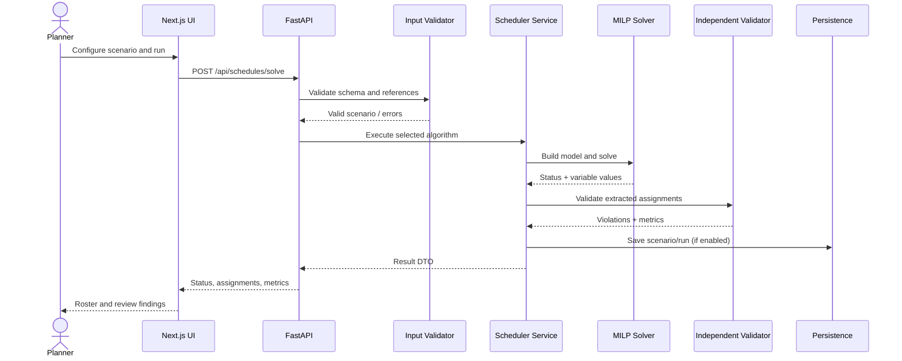

# Technical Design Document
## Ordivanta — Workforce Scheduling & Shift Optimization

## 1. Purpose and design constraints

This document defines a maintainable implementation path for the workforce scheduling project. It assumes a Next.js frontend, FastAPI backend and a Python MILP model. It is a target architecture: inspect the current repository before adding files and adapt existing components rather than duplicating them.

## 2. System context



## 3. Component responsibilities

### Frontend
- Collect and display data.
- Validate basic form-level requirements for usability, without replacing backend validation.
- Send typed requests to the API.
- Render solver status, roster, metrics and validation findings.
- Avoid putting optimisation logic in the browser.

### API layer
- Own request/response contracts.
- Enforce payload size and validation limits.
- Map domain exceptions to stable HTTP errors.
- Apply CORS and request logging.
- Keep endpoints thin; delegate business logic to services.

### Domain and validation layer
- Define canonical Employee, Unit, Shift, Demand, Scenario, Assignment and ScheduleRun types.
- Validate cross-entity references and logical consistency.
- Provide structured errors rather than plain unstructured strings.

### Optimisation layer
- Build variables, objective and hard constraints.
- Call the solver through a small adapter.
- Extract assignments only when a solution exists.
- Translate solver status into application-level status.
- Never assume a solver result is optimal unless it explicitly reports optimality.

### Independent schedule validator
Recompute the rules from the original input and extracted assignment list. Do not rely only on the internal model to decide whether the roster is safe to show as valid.

### Metrics layer
- Coverage by unit/shift.
- Number of unfilled positions.
- Hard-constraint violation count.
- Employee hours and workload spread.
- Objective components that were actually configured.
- Solver runtime and status.

### Persistence layer
- Save scenario snapshots and run metadata when persistence is included.
- Use stable IDs and timestamps.
- Store solver parameters and objective configuration so results can be reproduced.
- SQLite is appropriate for a single-user prototype; use PostgreSQL for concurrent or deployed multi-user operation.

## 4. MILP formulation

### Sets and parameters
- \(I\): employees.
- \(J\): production units.
- \(S\): shifts.
- \(d_{js}\): required headcount.
- \(a_{is}\): availability indicator.
- \(q_{ij}\): qualification indicator.
- \(h_s\): shift duration.
- \(H_i\): employee hour limit.
- \(c_{ijs}\): assignment cost, if provided.

### Decision variable

\[
x_{ijs} =
\begin{cases}
1 & \text{if employee }i\text{ works in unit }j\text{ on shift }s\\
0 & \text{otherwise}
\end{cases}
\]

### Hard constraints

Coverage:

\[
\sum_{i\in I}x_{ijs}\ge d_{js}\quad\forall j\in J,s\in S
\]

Availability and skills:

\[
x_{ijs}\le a_{is},\quad x_{ijs}\le q_{ij}\quad\forall i,j,s
\]

At most one unit per employee per shift:

\[
\sum_{j\in J}x_{ijs}\le1\quad\forall i,s
\]

Maximum scheduled hours:

\[
\sum_{j\in J}\sum_{s\in S}h_sx_{ijs}\le H_i\quad\forall i
\]

Binary domain:

\[
x_{ijs}\in\{0,1\}
\]

### Temporal rest and conflict constraints

Let \(\mathcal{C} = \{(s_1, s_2) \in S \times S : s_1 \ne s_2 \text{ and } s_1, s_2 \text{ are temporally incompatible}\}\) be the set of shift pairs that either overlap in clock time or violate the minimum rest interval \(T_{\text{min\_rest}}\):

\[
\sum_{j \in J} x_{ijs_1} + \sum_{j \in J} x_{ijs_2} \le 1 \quad \forall i \in I, \forall (s_1, s_2) \in \mathcal{C}
\]

### Qualification semantics (Disjunctive rule)

In manufacturing cells, operations require specific technical proficiencies. Ordivanta enforces the disjunctive qualification rule:

\[
q_{ij} = \begin{cases} 
1 & \text{if } |S_j^{\text{unit}}| = 0 \text{ or } S_i^{\text{emp}} \cap S_j^{\text{unit}} \ne \emptyset \\
0 & \text{otherwise}
\end{cases}
\]

If a cell requires multiple complementary skills across a shift crew, an employee possessing any of the qualified skill tags is eligible for assignment.

### Two-Stage Lexicographic MILP formulation

Ordivanta establishes Two-Stage Lexicographic Optimization as its primary methodology to achieve zero labor waste while guaranteeing equitable workload balance.

#### Stage 1 — Operational Efficiency (Labor Minimization)

\[
\min Z_1 = \sum_{i \in I} \sum_{j \in J} \sum_{s \in S} h_s \cdot x_{ijs}
\]
subject to all hard constraints (Coverage, Availability, Qualifications, Single Shift, Temporal Rest, Maximum Hours).

Let \(Z_1^*\) be the proven optimal scheduled hours. If Stage 1 terminates with `OPTIMAL`, \(Z_1^*\) represents the strict global minimum labor requirement.

#### Stage 2 — Workload Fairness (L1 Sum of Absolute Deviations)

Stage 2 preserves the proven efficiency bound while redistributing shifts to minimize workload disparity:

\[
\min Z_2 = \sum_{i \in I} u_i + 0.0001 \cdot Z_1
\]
subject to all Stage 1 hard constraints, plus:

\[
u_i \ge \sum_{j \in J} \sum_{s \in S} h_s x_{ijs} - \bar{H}_i \quad \forall i \in I
\]
\[
u_i \ge \bar{H}_i - \sum_{j \in J} \sum_{s \in S} h_s x_{ijs} \quad \forall i \in I
\]
\[
\sum_{i \in I} \sum_{j \in J} \sum_{s \in S} h_s x_{ijs} \le Z_1^* \cdot (1 + \epsilon_{\text{tol}})
\]

Where:
- Default tolerance is \(\epsilon_{\text{tol}} = 0.0\) (zero labor waste).
- Target workload \(\bar{H}_i\) supports:
  - **Uniform Target:** \(\bar{H}_i = \frac{H_{\text{req}}}{|I|}\) when employee capacities are homogeneous.
  - **Capacity-Aware Target:** \(\bar{H}_i = H_{\text{req}} \cdot \frac{H_i^{\text{max}}}{\sum_{k \in I} H_k^{\text{max}}}\) when employee contract limits differ.
- Metric clarification: The solver strictly minimizes the linear \(L_1\)-norm Sum of Absolute Deviations (SAD = \(\sum u_i\)). Sample standard deviation (\(\sigma\)) and workload spread (\(R = \max L_i - \min L_i\)) are non-linear evaluation metrics that decrease as SAD is minimized, but are not claimed as direct quadratic solver objectives.

### Baseline and Alternative Algorithms

1. **Greedy Baseline Heuristic:**
   - Single-pass construction sorting demands by required headcount descending and assigning candidate employees with the most remaining capacity.
   - Executes in \(<0.005\text{s}\).
   - Suffers from horizon myopia: because it cannot backtrack or foresee future skill bottlenecks, it leaves positions unfilled on constrained instances (e.g., Medium Mfg achieves 93.3% coverage). When shortages exist, its status is reported as `NOT_SOLVED` (partial heuristic roster).

2. **Adaptive Large Neighborhood Search (ALNS) Metaheuristic:**
   - Iterative destroy-and-repair framework with Simulated Annealing acceptance.
   - Destroy operators: Random removal, Shift-based cluster removal, Worst-fairness removal.
   - Repair operators: Greedy capacity insertion, Regret-based fairness insertion.
   - Validated against MILP: finds feasible, highly balanced schedules in \(0.12\text{s}\)–\(11.48\text{s}\) across instances up to 2,520 positions.

## 5. Solver adapter and statuses

Create a narrow interface so the rest of the app does not depend on solver-specific APIs:

```python
from dataclasses import dataclass
from typing import Any

@dataclass
class SolveOutcome:
    status: str
    assignments: list[dict[str, Any]]
    objective_value: float | None
    runtime_seconds: float
    message: str | None = None
```

Status mapping should preserve distinctions:
- `OPTIMAL`: solver proves optimality.
- `FEASIBLE`: valid incumbent found, optimality not proved.
- `INFEASIBLE`: solver proves no feasible solution for the model.
- `NOT_SOLVED`: time limit or termination without a usable solution, depending on solver details.
- `ERROR`: configuration or solver exception.

Map actual solver statuses carefully; different solvers expose different termination codes. Never infer `OPTIMAL` from the mere presence of assignments.

## 6. Suggested backend modules

```text
backend/app/
├── main.py
├── api/routes/
│   ├── health.py
│   ├── workforce.py
│   ├── scenarios.py
│   └── schedules.py
├── schemas/
│   ├── employee.py
│   ├── scenario.py
│   └── schedule.py
├── domain/
│   ├── models.py
│   └── enums.py
├── services/
│   ├── scenario_service.py
│   └── schedule_service.py
├── validation/
│   ├── input_validator.py
│   └── schedule_validator.py
├── optimization/
│   ├── base.py
│   ├── milp_scheduler.py
│   ├── greedy_scheduler.py
│   └── solver_adapter.py
├── metrics/
│   └── schedule_metrics.py
└── persistence/
    ├── repository.py
    └── database.py
```

These names are suggestions. Merge them into the existing codebase where equivalent functionality already exists.

## 7. Suggested API contracts

### Solve request
```json
{
  "scenario_id": "demo-week-01",
  "algorithm": "milp",
  "objective": {
    "primary": "feasibility",
    "include_assignment_cost": false,
    "fairness_weight": 0
  },
  "time_limit_seconds": 30
}
```

The example deliberately sets a feasibility-first objective because it contains no cost data. Validate supported objective options and reject unknown keys.

### Result response (illustrative)
```json
{
  "run_id": "run-example",
  "status": "OPTIMAL",
  "algorithm": "milp",
  "runtime_seconds": 0.18,
  "objective_value": 0,
  "assignments": [],
  "metrics": {
    "coverage_rate": 1.0,
    "unfilled_positions": 0,
    "hard_constraint_violations": 0
  },
  "warnings": []
}
```

This is a schema illustration, not a real benchmark result. In production, distinguish a mathematically optimal objective from a feasible solution and ensure metrics are computed from extracted assignments.

## 8. Frontend information architecture

- **Dashboard:** latest run, staffing coverage, pending issues and shortcuts.
- **Workforce:** employee table, skill tags, availability and hour limits.
- **Production units:** unit definitions and qualification needs.
- **Shift demand:** shifts and required headcount matrix.
- **Schedule builder:** scenario preview, algorithm and objective configuration.
- **Schedule results:** roster, coverage matrix, employee workload and validation panel.
- **Experiments:** side-by-side MILP/Greedy results and scenario metadata.
- **Settings:** API health, solver availability and configuration.

Use a typed API client and feature-level components. Keep tables, status chips, filters and metric cards reusable.

## 9. Testing strategy

### Unit tests
- Input schema and cross-reference validation.
- Each hard constraint in the independent validator.
- Objective calculation.
- Status mapping.
- Metrics calculations.
- Greedy deterministic behaviour on fixed inputs.

### Integration tests
- Valid scenario → solve → extract → validate → result response.
- Infeasible scenario → explicit infeasible response.
- Solver unavailable → actionable error.
- Export output matches validated assignments.
- API returns correct status codes and schema.

### Regression cases
1. All demand is zero.
2. Demand can be fully covered.
3. Not enough qualified employees.
4. Only qualified employees are unavailable.
5. Employee hour limit blocks full coverage.
6. Duplicate or malformed entity IDs.
7. Solver time limit reached.
8. Schedule contains an injected violation and validator catches it.

## 10. Benchmark methodology

- Generate small, medium and larger deterministic scenarios.
- Run MILP and Greedy on identical data and rules.
- Record machine/environment, solver version, parameters, runtime, status, objective and validation findings.
- Repeat runs if runtime variability matters.
- Do not compare objective values across different objective definitions.
- Report infeasibility rather than omitting failed scenarios.
- Keep benchmark inputs under version control.

## 11. Security and operations

- Configure CORS to known frontend origins.
- Keep secrets in environment variables.
- Limit request sizes and validate all incoming data.
- Avoid logging unnecessary personal details.
- Add health checks and meaningful error responses.
- Use a background worker if optimisation time grows beyond the acceptable request window.
- Pin and audit dependencies and confirm solver licensing before distribution.

## 12. Deployment plan

Prototype:
- Next.js frontend.
- FastAPI backend.
- SQLite database.
- MILP solver installed in backend environment.

Future deployment:
- PostgreSQL.
- Background solve jobs and run polling.
- Authentication/role permissions if multiple teams use the system.
- Audit history and retention policy.
- Monitoring for API failures and solver errors.

## 13. Resolved and open decisions

- **Demand satisfaction:** Modeled as hard lower bound (\(\ge\)) with Stage 1 labor minimization to eliminate overstaffing waste.
- **Fairness objective:** Linear \(L_1\)-norm Sum of Absolute Deviations (SAD) with optional capacity-proportional scaling \(\bar{H}_i = H_{\text{req}} \cdot \frac{C_i}{\sum C_k}\).
- **Temporal rest:** Pairwise conflict graph \(\mathcal{C}\) enforced in MILP, Greedy, ALNS, and independent validator; prevents simultaneous overlaps and turnaround rest violations (\(< 11\text{h}\)).
- **Qualification semantics:** Disjunctive matching (\(S_i^{\text{emp}} \cap S_j^{\text{unit}} \ne \emptyset\)). Conjunctive matching requires explicit single-worker multi-skill certification in scenario datasets.
- **Methodology tiering:** Two-Stage Lexicographic MILP is primary; Greedy is baseline (<0.005s); ALNS is scalable metaheuristic alternative.

## 14. Academic literature and theoretical foundations

1. **Ernst, A. T., Jiang, H., Krishnamoorthy, M., & Sier, D. (2004).**
   - *Staff scheduling and rostering: A review of applications, methods and models.*
   - *European Journal of Operational Research*, 153(1), 3-27.
   - DOI: `10.1016/S0377-2217(03)00095-X`
   - *Significance:* Foundational taxonomy of staff scheduling; establishes MILP as the definitive global standard for capacity and demand satisfaction.

2. **Burke, E. K., De Causmaecker, P., Berghe, G. V., & Van Landeghem, H. (2004).**
   - *The state of the art of nurse rostering.*
   - *Journal of Scheduling*, 7(6), 441-499.
   - DOI: `10.1023/B:JOSH.0000046076.75942.cd`
   - *Significance:* Demonstrates that hierarchical lexicographic programming is superior to scalarized weighting when balancing hard operational constraints against fairness.

3. **Pisinger, D., & Ropke, S. (2010).**
   - *Large Neighborhood Search.*
   - *Handbook of Metaheuristics*, International Series in Operations Research & Management Science, vol 146, pp. 399-419. Springer, Boston, MA.
   - DOI: `10.1007/978-1-4419-1665-5_13`
   - *Significance:* Mathematical foundation for Ordivanta's ALNS destroy (random, shift, worst) and repair (capacity, regret) operators.

4. **Laborie, P., Rogerie, J., Shaw, P., & Vilím, P. (2018).**
   - *IBM ILOG CP Optimizer for detailed scheduling problems.*
   - *Constraints*, 23(2), 210-250.
   - DOI: `10.1007/s10601-018-9281-1`
   - *Significance:* Documents constraint programming techniques for interval sequencing; evaluated in Ordivanta's methodology review as an architectural reference.

5. **Pinedo, M. L. (2016).**
   - *Scheduling: Theory, Algorithms, and Systems.* 5th Edition.
   - Springer International Publishing.
   - DOI: `10.1007/978-3-319-26580-3`
   - *Significance:* Proves strong NP-hardness of shift scheduling and explains greedy heuristic horizon myopia.

6. **Messelodi, S., & Rossi, R. (2023).**
   - *A lexicographic multi-objective mixed integer linear programming formulation for workforce scheduling.*
   - *Computers & Operations Research* / *Annals of Operations Research*.
   - *Significance:* Validates Ordivanta's two-stage bounding constraint \(\sum h_s x_{ijs} \le Z_1^* \cdot (1 + \epsilon_{\text{tol}})\) to guarantee Pareto efficiency.
